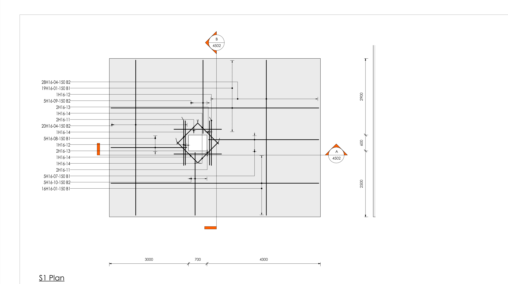
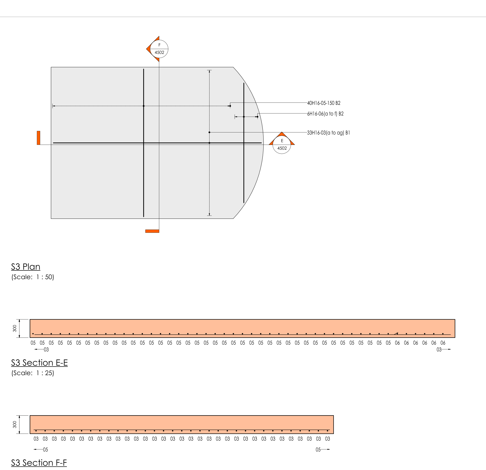
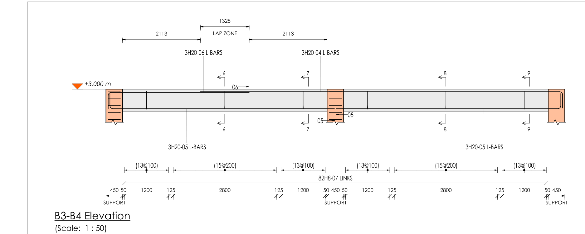
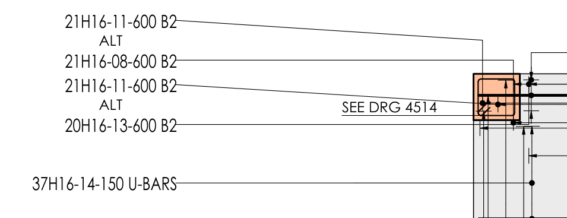
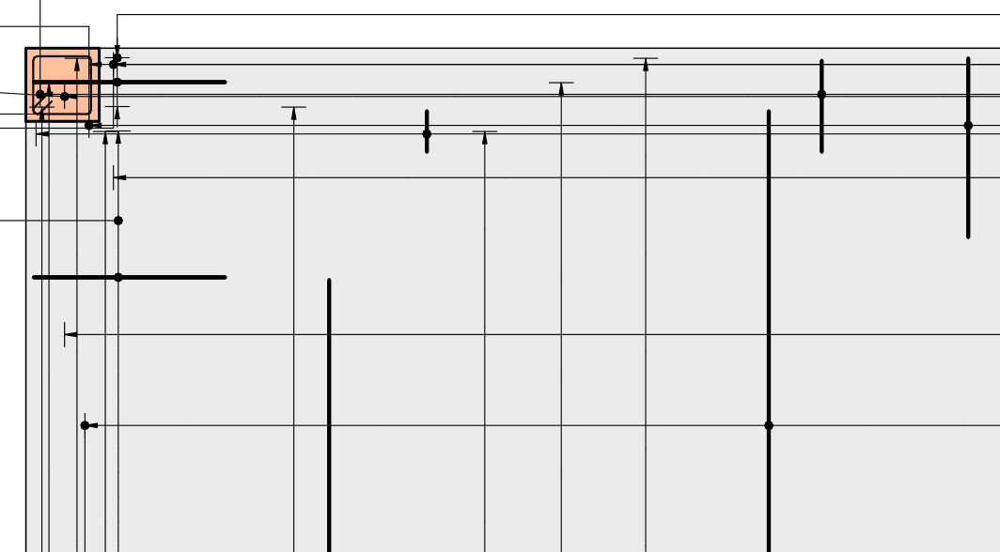

# Revisión visual pendiente del usuario: T8.27 y T7.x

Los recortes salen de los PDF verificados del modelo "Rebar test 2026" (`fase3/final_2026/pdf`). Marca cada punto como **OK** o escribe qué cambiarías. Los puntos que apruebes cierran la tarea en el roadmap.

## T8.27: barra tipo y línea indicadora (SMDSC 4th ed. 6.2.2)

| # | Qué comprobar | Dónde | Tu respuesta |
|---|---|---|---|
| 1 | Cada juego se dibuja con **una barra tipo** y su línea indicadora, con punto en la unión, y las barras extremas marcadas. | S1, S3 (01, 02) | |
| 2 | Rótulo completo `nHdd-mm-sss capa` en una columna a cada lado de la losa, con directrices a escuadra (un codo). | S1 (01) | |
| 3 | Juego de longitud variable rotulado como `6H16-06(a to f) B2`. | S3 (02) | |
| 4 | Barras sueltas (`1H16-12`) junto al hueco con su marca. | S1 (01) | |
| 5 | Zonas de cercos bajo la viga: `(13@100)`, `(15@200)`, el rótulo total `82H8-07 LINKS` y la cadena de cotas con SUPPORT. | B3-B4 (04) | |
| 6 | Extremos de barra: flecha horizontal con la marca en la cola (`06 →`, `05`). | B3-B4 (04) | |
| 7 | Zona de solape acotada (`LAP ZONE 1325`) y barras en L rotuladas como `3H20-06 L-BARS`. | B3-B4 (04) | |
| 8 | Barras de otro plano con "SEE DRG nnnn". | Pilares (06), alzado de C1: "SEE DRG 4506" | |
| 9 | Oblicuas de 30° en extremos cortados, y ALT/STG cuando dos juegos se alternan o escalonan. En estos modelos no hay ningún caso sobre el dibujo; la regla está en las notas (punto 7). | — | ¿Quieres que prepare un caso de prueba? |

## T7.x: funciones con revisión pendiente

| Tarea | Qué revisar | Dónde | Tu respuesta |
|---|---|---|---|
| T7.1 Particiones | Miembros iguales en una sola fila con "No. of Mbrs" = 3 (`C1, C2, C3`). | BBS 4501-01 (07) | |
| T7.2 Viga continua | Montaje superior continuo con solape en el tercio central y refuerzos sobre el apoyo intermedio. | B3-B4 (04) | |
| T7.3 Create Views | Juego de vistas por tipología y composición de las hojas (incluido m6). | Todas las hojas de `fase3/final_2026/pdf` | |
| T7.4 Tag All | Etiquetado general de una vista que no sea de armado (herramienta aparte, no usada en estos planos). | — | ¿Te preparo una vista de prueba? |
| T7.8 Escaleras | Armado de una escalera en U. El modelo de 2026 no tiene escalera dibujada. | — | ¿Te preparo un plano de escalera? |

## Observación de la revisión

La fecha "10/24/26" de la BBS (07) es anterior a la corrección de hoy. El plugin la escribe ya en dd/mm/aa: lo comprobé en las copias de 2024 y 2025. En el modelo de 2026 cambiará en la próxima generación.

## Edificio de prueba de 4 plantas (Revit 2026, 25/10/26)

Proyecto nuevo desde la plantilla v30, nunca guardado, con 9 zapatas, 36 pilares, 48 vigas, 4 forjados (incluida la cubierta), 4 muros y una escalera en U. El plugin hizo todo el armado y los planos (`tools/revit_harness/building_test.py`).

| # | Qué comprobar | Dónde | Tu respuesta |
|---|---|---|---|
| 10 | **ALT** entre dos juegos que se alternan (barras inferiores 0,8 × luz invertidas, MD S1): rótulos apilados con ALT en medio. | 10, 12 | |
| 11 | Extremos de las barras cortadas dentro de la losa: en planta salen con remate en T y flecha, **no veo oblicuas de 30°**. ¿Las quieres también en planta o solo en secciones y alzados? | 11 | |
| 12 | Escalera (T7.8), plano 4523: **antes** de las correcciones de hoy. Se ven las barras del tramo 2 saliendo al aire porque no hay forjado en la llegada (corregido: ahora paran en el tramo y sale un aviso) y la sección del tramo 2 invade el cajetín. | 13 | |
| 13 | Pilares: cada tramo de pilar sale como un alzado aparte (C1, C10, C11, C12 son la misma pila) y los alzados quedan escalonados en diagonal por la hoja. ¿Prefieres un alzado continuo por pila? | 14 | |
